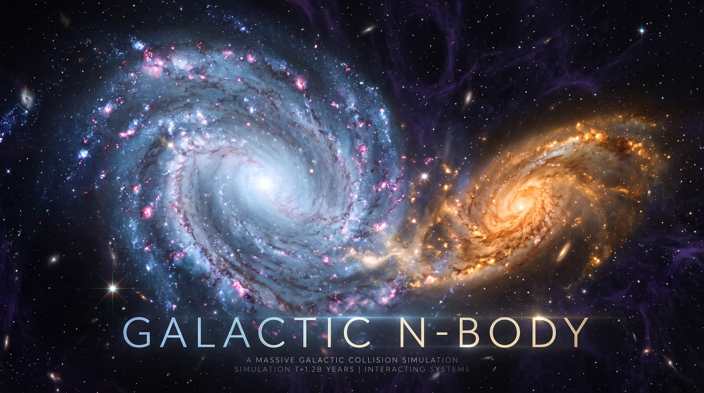
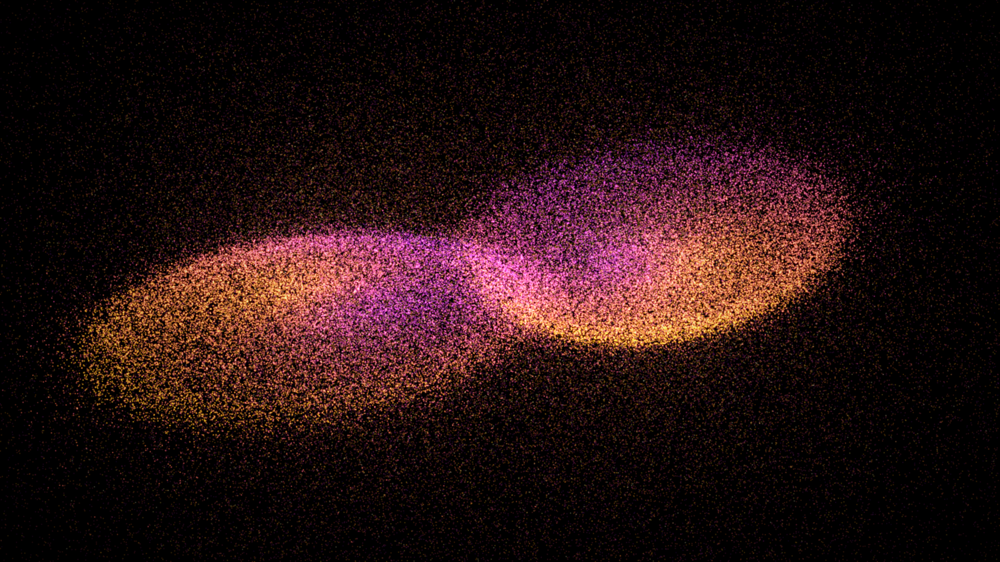
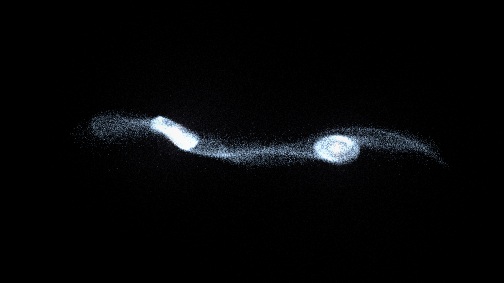
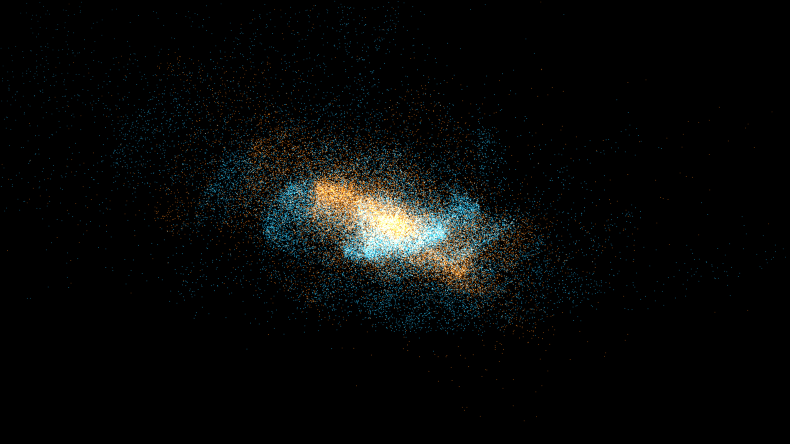
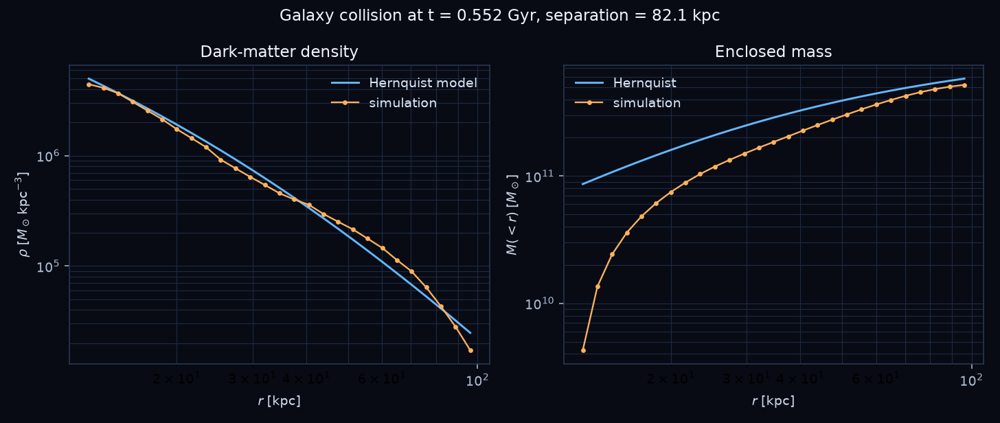

# Galactic N-Body

A compact, fully self-contained 3D N-body laboratory: two colliding disk galaxies
and a ΛCDM cosmic web, both evolved with the same particle-mesh gravity solver,
rendered with a software splatterer, and driven by a pygame interface or from the
command line. It supports up to **8,000,000 particles** and runs end-to-end on a
CPU-only machine.

No OpenGL, no GPU, no audio, no network. Python 3.10+ with numpy, scipy, numba,
pygame, pillow and matplotlib.

---

## Screenshots

### 1. Galaxy collision (Color Density)



### 2. Galaxy collision (White Density)



### 3. Galaxy collision (Scatter)



### 4. Analysis output



---

## Features

- Two scenes: a **galaxy collision** with a Hernquist halo + bulge and an
  exponential/sech² disk, and a **cosmic web** grown from Zel'dovich initial
  conditions in a flat ΛCDM box.
- Particle-mesh gravity with cloud-in-cell (CIC) deposition and interpolation,
  Fourier Poisson solve, CIC window deconvolution, Gaussian smoothing and a
  4-point gradient. The collision scene uses an isolated **Hockney–Eastwood 2×
  padded** solve with a `-G/r` Green's function; the cosmic scene uses a
  periodic solve with the `k = 0` mode removed.
- Kick–drift–kick leapfrog with a **global adaptive timestep**.
- Self-consistent galaxy initial conditions: Jeans dispersions, Toomre
  `Q = 1.5`, asymmetric drift, a Kepler pair orbit, and two independently
  inclined disks.
- Adaptive isolated box with 10% hysteresis, refreshed every 50 steps.
- Live pygame UI: double-buffered, lock-protected snapshots, orbit camera,
  colour modes, dark-matter toggle, cosmic slab control, PNG export, 1920×1080
  capture, frame recording, restart and a help overlay.
- Headless modes: single PNG, PNG sequence, and analysis plots. **Pygame is
  never imported in headless mode.**
- Pure-NumPy fallback when numba is unavailable: it warns and automatically
  reduces the defaults.

---

## Installation

```bash
git clone <your-repo-url> galactic-nbody
cd galactic-nbody
python -m venv .venv
source .venv/bin/activate
pip install -r requirements.txt
```

Python 3.10 or newer is required. On a fresh machine the first numba call
compiles the kernels and takes a few seconds; later runs use the on-disk cache.

---

## Quick Start

```bash
# Interactive galaxy collision (250k particles, 64^3 grid)
python main.py

# Interactive cosmic web
python main.py --scene cosmic

# Headless single renders
python main.py --render images/collision.png
python main.py --scene cosmic --render images/cosmic.png

# A PNG sequence, then analysis
python main.py --frames images/frames --frame-count 90
python main.py --scene cosmic --analyze
```

---

## Command-Line Options

| Option | Meaning | Default |
| --- | --- | --- |
| `--scene {collision,cosmic}` | Simulation scene | `collision` |
| `--quality {preview,high,ultra}` | Particle/grid/resolution preset | `preview` |
| `--particles N` | Particle count, `1000 … 8,000,000` | preset |
| `--grid G` | PM grid size per dimension, `8 … 512` | preset |
| `--width W`, `--height H` | Interactive window size | preset |
| `--seed S` | Random seed | `12345` |
| `--box L` | Cosmic box side in Mpc/h | `100` |
| `--z-start Z` | Cosmic starting redshift | `49` |
| `--mass-ratio q` | Secondary / primary mass | `1.0` |
| `--pericenter R` | Pair pericentre in kpc | `15` |
| `--eccentricity e` | Pair eccentricity | `1.0` |
| `--separation R` | Initial pair separation in kpc | `80` |
| `--incl1 DEG`, `--incl2 DEG` | Disk inclinations | `0`, `60` |
| `--steps N` | Fixed number of steps (headless) | scene endpoint |
| `--render PATH` | Write one PNG and exit | — |
| `--frames DIR` | Write a PNG sequence and exit | — |
| `--frame-count N` | Number of frames | `90` |
| `--analyze` | Run and save a diagnostic plot | — |

Without `--steps`, the collision scene advances to about **0.55 Gyr** (safety cap
800 steps) and the cosmic scene stops exactly at **a = 1** (safety cap 400
steps).

### Quality presets

| Preset | Particles | Grid | Render size | Typical use |
| --- | --- | --- | --- | --- |
| `preview` | 250,000 | 64³ | 640×360 | live interaction |
| `high` | 2,000,000 | 128³ | 960×540 | live / short movies |
| `ultra` | 8,000,000 | 256³ | 1280×720 | offline renders |

`ultra` is deliberately an offline target: the UI remains responsive because
simulation and rendering run in separate threads, but a live 8M-particle view is
limited by the software renderer.

---

## Interactive Controls

| Input | Action |
| --- | --- |
| Left mouse drag | Orbit the camera |
| Mouse wheel | Zoom |
| Arrow keys | Orbit / change inclination |
| `SPACE` | Pause / resume |
| `C` | Cycle colour mode (galaxy, component, density, speed) |
| `D` | Show / hide dark matter (collision) |
| `+` / `-` | Increase / decrease simulation speed |
| `[` / `]` | Decrease / increase cosmic slab thickness |
| `S` | Save the current preview PNG to `images/` |
| `F` | Save a 1920×1080 PNG |
| `V` | Start / stop frame recording |
| `R` | Reset the camera |
| `T` | Restart with a new seed |
| `H` | Toggle the help overlay |
| `ESC` | Quit |

---

## Physics

### Units

The collision scene uses **kpc, km/s, M☉**, so `G = 4.30091 × 10⁻⁶
kpc (km/s)² M☉⁻¹` and one time unit is `0.9778 Gyr`. The cosmic scene uses
comoving **Mpc/h** and `H₀ = 100 km/s/(Mpc/h)`, i.e. `h = 0.68`,
`Ω_m = 0.30`, `Ω_Λ = 0.70`, `σ₈ = 0.80`, `n_s = 0.96`.

### Particle-mesh gravity

Particles are assigned to the grid with CIC weights, the density is transformed
with `scipy.fft.rfftn(..., workers=-1)` (or `numpy.fft` if scipy is absent),
multiplied by the Poisson kernel, and differentiated with a 4-point central
gradient. Each Fourier mode is divided by the CIC assignment window so that the
force is not artificially smoothed by the mass-assignment kernel. A Gaussian
smoothing of `0.30` cells suppresses grid-scale noise.

- **Periodic (cosmic):** `k = 0` is set to zero; the kernel uses `1/h³` so that
  particle masses are dimensionless overdensity weights.
- **Isolated (collision):** Hockney–Eastwood 2× zero padding and the analytic
  `-G/r` Green's function give vacuum boundary conditions. Physical cell masses
  are used directly.

The CIC deposit conserves mass exactly, and the periodic force conserves total
momentum to round-off.

### Galaxy initial conditions

The primary has `M_halo = 10¹² M☉` (Hernquist, `a = 30 kpc`, truncated at
100 kpc), `M_bulge = 10¹⁰ M☉` (Hernquist, `a = 0.7 kpc`), and
`M_disk = 5 × 10¹⁰ M☉` (exponential, `R_d = 3.5 kpc`, `z_d = 0.35 kpc`,
sech² vertical profile). The secondary is scaled by `--mass-ratio`. The stellar
disk always receives at least 25% of the particles; the rest follow the mass
fractions.

Radial velocity dispersions come from the spherical Jeans equation,

```
σ²(r) = (1/ρ) ∫_r^R ρ(r') G M(<r') / r'² dr',
```

and the disk is given a Toomre `Q = 1.5` radial dispersion. Asymmetric drift is
included through

```
v_φ² = v_c² − σ_R² [ d ln Σ/d ln R + d ln σ_R²/d ln R
                     + 1 − κ²/(4Ω²) ].
```

The pair is placed on a Kepler orbit from `--separation`, `--pericenter` and
`--eccentricity`, with independent disk inclinations. The two galaxies are then
recentred to zero total momentum.

### Cosmic initial conditions

The Eisenstein–Hu no-wiggle transfer function is normalized to `σ₈ = 0.8`, and
a deterministic Gaussian random field is generated in Fourier space from the
same seed. Particles start at `z = 49` on a uniform grid with Zel'dovich
displacements and velocities. The linear growth factor is obtained by exact
integration of

```
D(a) ∝ H(a) ∫_0^a da' / (a' H(a'))³,
```

normalized to `D(1) = 1`. For an Einstein–de Sitter universe this reduces to
`D = a`; for the default cosmology `D(1) = 0.779` before normalization.

The cosmic evolution is a comoving leapfrog in `ln a`:

```
dx/d ln a = p / (a² H),
dp/d ln a = −∇φ / H,
∇²φ = (3/2) Ω_m δ / a.
```

### Integrator

Both scenes use kick–drift–kick leapfrog. The collision timestep is

```
dt = min( η √(ε/a_max), 0.5 · cell / v_max ),
```

with `η = 0.2`. The cosmic timestep is limited by the maximum displacement per
`ln a` and by the remaining distance to `a = 1`. The collision box is refreshed
every 50 steps only when the 99th-percentile radius moved by more than 10%
(10% hysteresis).

---

## Output

- `--render PATH` writes one PNG after advancing the scene.
- `--frames DIR` writes `frame_0000.png`, `frame_0001.png`, … evenly spaced
  over the requested run.
- `--analyze` writes `images/analysis_cosmic.png` (measured versus linear
  `P(k)`) or `images/analysis_collision.png` (dark-matter density and enclosed
  mass versus Hernquist).
- The live UI writes captures to `images/render_*.png`, `images/frame_1920_*.png`
  and, while recording, `images/record_*/frame_*.png`.

---

## Testing

```bash
python -m pytest -q
```

The suite checks:

- CIC mass conservation in periodic and isolated boxes;
- the isolated point-mass force against `G M / r²` beyond 3–4 cells (5%);
- periodic momentum conservation;
- leapfrog energy drift over 10 orbits (< 10⁻³) and time reversibility;
- Hernquist enclosed mass and circular velocity against numerical integrals
  (5%), plus a sampled-halo virial ratio in `0.7 … 1.3`;
- `D(1) ≈ 0.779` unnormalised, `D(1) = 1` normalised, and `D = a` for EdS;
- a cosmic age of 13.5–13.9 Gyr and the `σ₈` normalization.

With warm numba caches the suite finishes in about one second; a cold run is
still well under a minute.

---

## Performance Notes

- `--quality preview` targets interactive use on 8 CPU cores; `high` is a good
  compromise for short captures; `ultra` is intended for `--render`/`--frames`.
- The renderer accumulates into one RGB buffer per thread and merges the
  buffers afterwards, so there are no races and no global locks in the splat
  loop.
- The simulation runs in a background thread and publishes immutable
  double-buffered snapshots. The UI never reads a particle array while it is
  being mutated.
- The memory guard estimates particle arrays, double buffers, FFT workspace,
  deposition temporaries and render buffers. If the request exceeds 90% of
  available RAM, the program exits with a clear error before allocating.
- On a machine without numba the program warns, forces the pure-NumPy path and
  caps the defaults at 50,000 particles and a 32³ grid.

---

## Limitations

This is an educational, collisionless PM code, not a research cosmology solver.
Be aware of the following:

- **No gas, star formation, feedback, black holes or magnetic fields.** Both
  scenes are pure N-body.
- **PM resolution is about two cells.** Structures smaller than that are
  smoothed away. In the collision scene the dark-matter cusp inside roughly two
  cells is flattened by the grid; the analysis plot therefore starts at two
  cells. In the cosmic scene a cell is 1–2 Mpc/h at the default settings, so
  individual halos and galaxies are not resolved.
- **The collision profile is not converged below the softening scale.** The
  solver uses cell-scale Gaussian smoothing rather than per-particle softening;
  very close encounters are softened by the grid.
- **Cosmic energy is not conserved.** The comoving equations include explicit
  time dependence through `a` and `H(a)`; the displayed cosmic energy is a
  diagnostic, not a conserved quantity. The UI hides its drift for that reason.
- **Global timestep.** All particles share one `dt`, chosen from the global
  maximum acceleration and speed. A single tightly bound particle can slow the
  whole run.
- **No MPI, GPU or tree gravity.** Everything is single-node, CPU-only, and the
  FFT cost scales as `N_grid³ log N_grid`. An 8M-particle `ultra` run with a
  256³ grid is an offline job.
- **The renderer is an artistic splatterer, not radiative transfer.** Colour
  modes, exposure, bloom and the cosmic slab are visual choices; they are not
  calibrated observables.
- **Initial conditions are approximate.** The Jeans/Toomre setup produces a
  reasonably cool disk, but it is not a full distribution-function model;
  transients at startup are possible, especially at low particle counts.
- **Pygame is required only for the live UI.** Headless rendering and tests
  never create a window.

---

## References

1. Hockney, R. W. & Eastwood, J. W. (1988). *Computer Simulation Using
   Particles*. Adam Hilger.
2. Hernquist, L. (1990). An analytical model for spherical galaxies and
   bulges. *ApJ*, 356, 359.
3. Toomre, A. (1964). On the gravitational stability of a disk of stars.
   *ApJ*, 139, 1217.
4. Binney, J. & Tremaine, S. (2008). *Galactic Dynamics* (2nd ed.). Princeton
   University Press.
5. Springel, V. (2005). The cosmological simulation code GADGET-2. *MNRAS*,
   364, 1105.
6. Eisenstein, D. J. & Hu, W. (1998). Baryonic features in the matter transfer
   function. *ApJ*, 496, 605.
7. Zel'dovich, Ya. B. (1970). Gravitational instability: an approximate theory
   for large density perturbations. *A&A*, 5, 84.
8. Barnes, J. & Hut, P. (1986). A hierarchical O(N log N) force-calculation
   algorithm. *Nature*, 324, 446.
9. Press, W. H., Teukolsky, S. A., Vetterling, W. T. & Flannery, B. P. (2007).
   *Numerical Recipes* (3rd ed.). Cambridge University Press.
10. Planck Collaboration (2020). Planck 2018 results. VI. Cosmological
    parameters. *A&A*, 641, A6.

---

## License

MIT. See [LICENSE](LICENSE).
